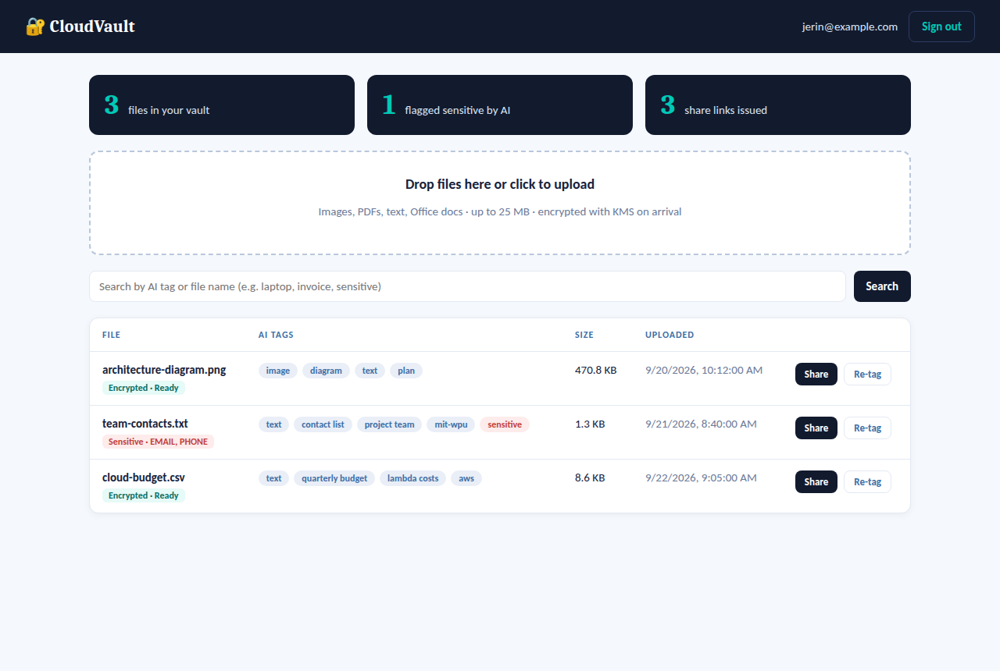
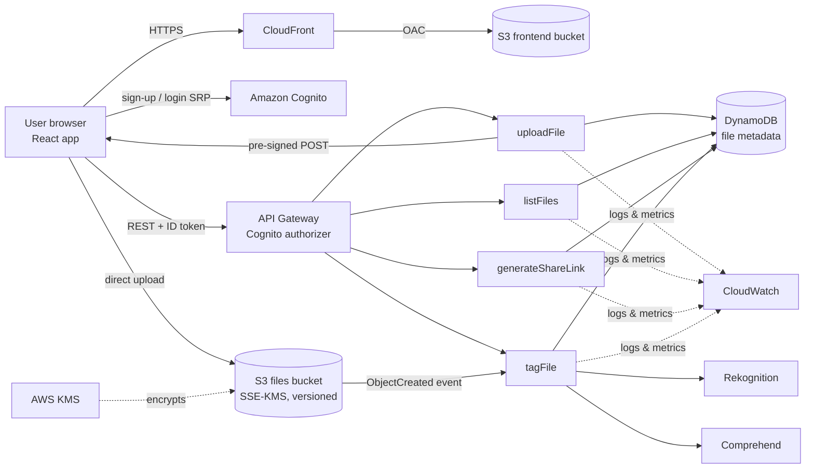

# CloudVault

**A secure serverless file storage & sharing system with AI-powered access control**
Cloud Computing PBL · B.Tech ECE (AI & ML), MIT-WPU · Bernardo Fernandes (1032232439) & Jerin Varghese (1032233427)

CloudVault lets a signed-in user upload files, which are encrypted with AWS KMS, automatically tagged by AI (Rekognition for images, Comprehend for text), searchable by those tags, and shared only through signed links that expire. If Comprehend finds personal data (emails, phone numbers, addresses…) in a file, CloudVault marks it **sensitive** and restricts its share links to 15 minutes. That is the "AI-powered access control".


*(UI preview rendered with sample data.)*

---

## Architecture



### Request lifecycle
1. **Login.** The user signs up and in with Cognito (email + password, SRP protocol) and receives a JWT ID token.
2. **Upload request.** The browser calls `POST /files/upload-url`. API Gateway validates the token. `uploadFile` stores a `PENDING_UPLOAD` record in DynamoDB and returns a **pre-signed S3 POST**, which is locked to one key, one content type and a 25 MB maximum, and is valid for 5 minutes.
3. **Direct upload.** The browser sends the file straight to S3. S3 encrypts it with the KMS key (SSE-KMS).
4. **AI tagging.** The S3 `ObjectCreated` event triggers `tagFile`:
   - images go to Rekognition labels;
   - text goes to Comprehend key phrases, entities and PII detection.

   The tags, the `sensitive` flag and `status=READY` are written to DynamoDB.
5. **Browse and search.** `GET /files?tag=…` returns only the caller's files, because the DynamoDB partition key is the Cognito user id.
6. **Share.** `POST /files/{id}/share` checks ownership, status and the AI rule, then returns a pre-signed GET URL that expires after 5 min, 15 min or 1 h.
7. **Monitoring.** Every step is logged to CloudWatch. Custom metrics, a dashboard and alarms show usage and errors.

---

## Repository layout

```
cloudvault/
├── backend/
│   ├── template.yaml            # AWS SAM / CloudFormation: all infrastructure as code
│   ├── src/
│   │   ├── common.py            # shared helpers (auth claims, CORS, errors, metrics)
│   │   ├── upload_file.py       # uploadFile       POST /files/upload-url
│   │   ├── list_files.py        # listFiles        GET  /files?tag=
│   │   ├── generate_share_link.py # generateShareLink POST /files/{fileId}/share
│   │   └── tag_file.py          # tagFile          S3 event + POST /files/{fileId}/tag
│   └── tests/test_handlers.py   # 14 unit tests (moto-mocked AWS)
├── frontend/                    # React + Vite app (Cognito auth, upload, search, share)
├── scripts/deploy.sh            # one-command deploy
├── scripts/teardown.sh          # delete everything
├── samples/                     # demo files (one clean, one with fake PII)
├── docs/                        # UI screenshots
└── EXAM_GUIDE.md                # viva / exam preparation
```

---

## Deploy it (about 15 minutes)

### Prerequisites
- An AWS account (the free tier is enough for a demo) and an IAM user or role with admin rights for deployment
- [AWS CLI v2](https://docs.aws.amazon.com/cli/latest/userguide/getting-started-install.html), configured with `aws configure`
- [AWS SAM CLI](https://docs.aws.amazon.com/serverless-application-model/latest/developerguide/install-sam-cli.html)
- Python 3.12 and Node.js 18 or newer
- On Windows, run the scripts from **Git Bash** or **WSL**

### Steps
```bash
cd cloudvault
./scripts/deploy.sh                       # us-east-1 by default
# or: AWS_REGION=ap-south-1 ./scripts/deploy.sh
```
The script prints the **CloudFront URL**. Open it, create an account, enter the emailed code, and upload files.

**Region.** `us-east-1` has every service this project uses. If you choose another region (for example Mumbai, `ap-south-1`, for lower latency), first confirm that Rekognition and Comprehend are available there.

**Recommended hardening after the first deploy.** Restrict CORS to your own site:
```bash
ALLOWED_ORIGIN=https://dxxxxxxxx.cloudfront.net ./scripts/deploy.sh
```

### Run locally
After one deploy, `frontend/.env` exists. Then:
```bash
cd frontend && npm install && npm run dev      # http://localhost:5173
```

### Run the tests (no AWS account needed)
```bash
cd backend
pip install -r requirements-dev.txt
pytest -v            # 14 tests
cfn-lint template.yaml
```

### Clean up (important, to avoid charges)
```bash
./scripts/teardown.sh
```

---

## API reference

All endpoints require the header `Authorization: <Cognito ID token>`.

| Method | Path | Lambda | Body / query | Returns |
|---|---|---|---|---|
| POST | `/files/upload-url` | uploadFile | `{fileName, contentType, size}` | `201 {fileId, upload:{url, fields}, expiresIn}` |
| GET | `/files` | listFiles | `?tag=laptop` (optional) | `200 {files:[…], count}` |
| POST | `/files/{fileId}/share` | generateShareLink | `{expiresIn: 300 \| 900 \| 3600}` | `200 {url, expiresAt}` · `403` if blocked by the AI rule |
| POST | `/files/{fileId}/tag` | tagFile | — | `200 {tags, sensitive, piiTypes}` |

**Error codes**

| Code | Meaning |
|---|---|
| 400 | Bad input |
| 401 | Missing or invalid token |
| 404 | File not found, or not yours |
| 409 | File not ready yet |
| 413 | File too large |
| 415 | File type not allowed |

### DynamoDB item (table `FilesTable`, PK `userId`, SK `fileId`)

```json
{
  "userId": "cognito-sub", "fileId": "32-hex", "fileName": "team-contacts.txt",
  "s3Key": "users/<sub>/<fileId>/team-contacts.txt", "contentType": "text/plain",
  "size": 1320, "status": "READY",
  "tags": ["text", "contact sheet", "sensitive"],
  "sensitive": true, "piiTypes": ["EMAIL", "PHONE"],
  "shareCount": 1, "uploadedAt": "…", "taggedAt": "…", "lastSharedAt": "…"
}
```

---

## Security controls

| Layer | Control |
|---|---|
| Identity | Cognito user pool with verified email, a password policy and SRP login (the password never crosses the network) |
| API | Cognito authorizer on every route, plus throttling (20 req/s, burst 50) |
| Authorization | User id taken from the **verified token**, never from the client; DynamoDB partition key = user id, which prevents IDOR |
| Storage | S3 Block Public Access (all 4 settings), bucket-owner-enforced ownership, deny non-HTTPS requests |
| Encryption | SSE-KMS with a customer-managed key (auto-rotation on, S3 Bucket Key on); DynamoDB encrypted at rest; TLS in transit |
| Uploads | Pre-signed POST policy pins the key, content type and size (1 B to 25 MB); type allow-list; file-name sanitisation |
| Sharing | Pre-signed GET URLs of 5 min, 15 min or 1 h; AI rule limits PII files to 15 min or less |
| Least privilege | Each Lambda has its own IAM role with only the actions and resources it needs |
| Recovery | S3 versioning (old versions kept 30 days), DynamoDB point-in-time recovery |
| Frontend | Private S3 bucket reachable only through CloudFront (Origin Access Control), HTTPS redirect, security headers |
| Monitoring | CloudWatch logs (14-day retention), custom metrics, dashboard, and alarms on API 5XX errors and tagging errors |

---

## Cost note
A classroom demo mostly stays within the AWS Free Tier. Three services still bill: Rekognition and Comprehend charge per request, and the customer-managed KMS key has a small monthly fee. Run `teardown.sh` after your evaluation.

## Troubleshooting

| Symptom | Fix |
|---|---|
| `CORS` error in the browser | You redeployed with `ALLOWED_ORIGIN` but are testing from `localhost`. Redeploy with `*`, or run locally against a stack deployed with `*`. |
| Upload returns 403 from S3 | The pre-signed POST expired (5 min) or the file is larger than 25 MB. Try again. |
| File stuck on "Analysing…" | Check the `tagFile` logs in CloudWatch. Rekognition or Comprehend may be unavailable in your region. |
| `UserNotConfirmedException` | Enter the verification code from the email, or use "Resend code". |
| Stack delete fails on a bucket | Use `scripts/teardown.sh`, which empties the versioned bucket first. |
